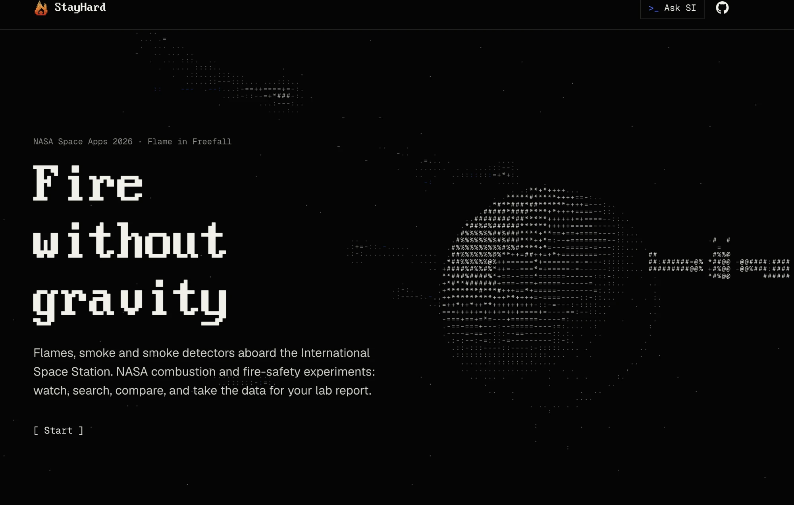
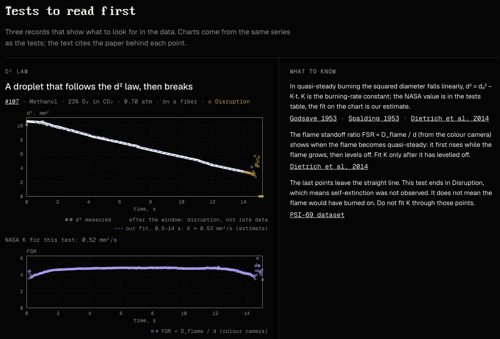
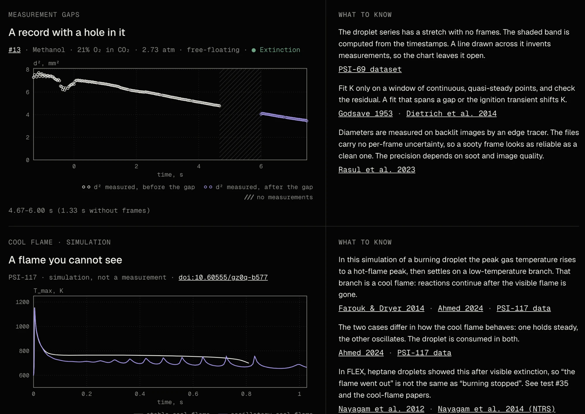
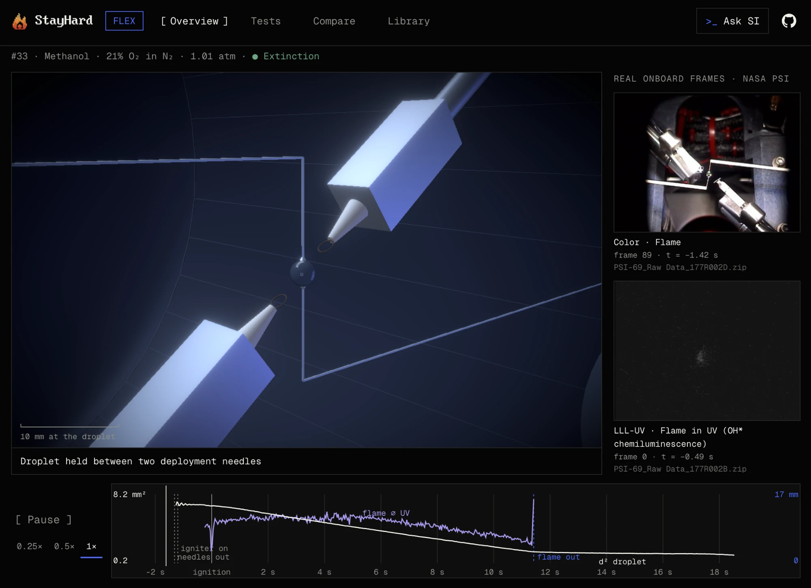
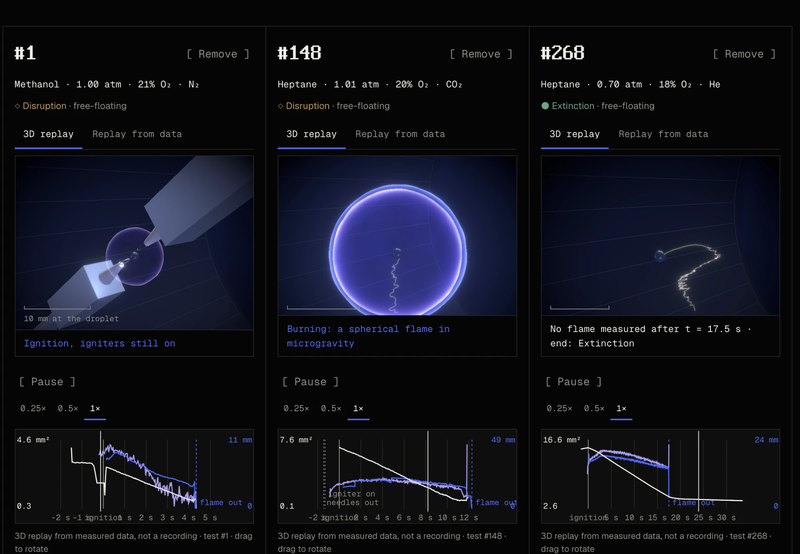
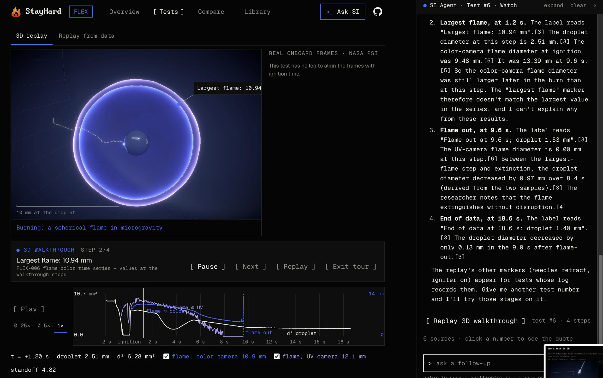
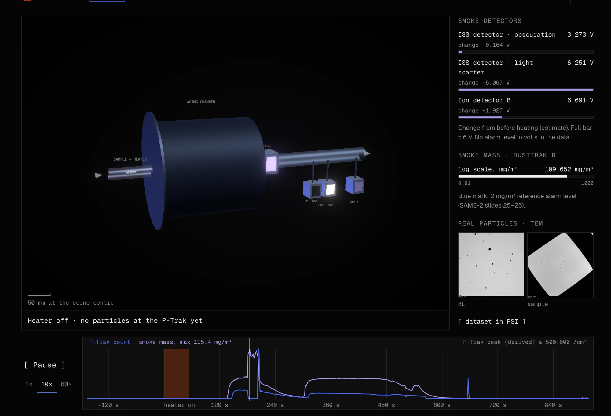
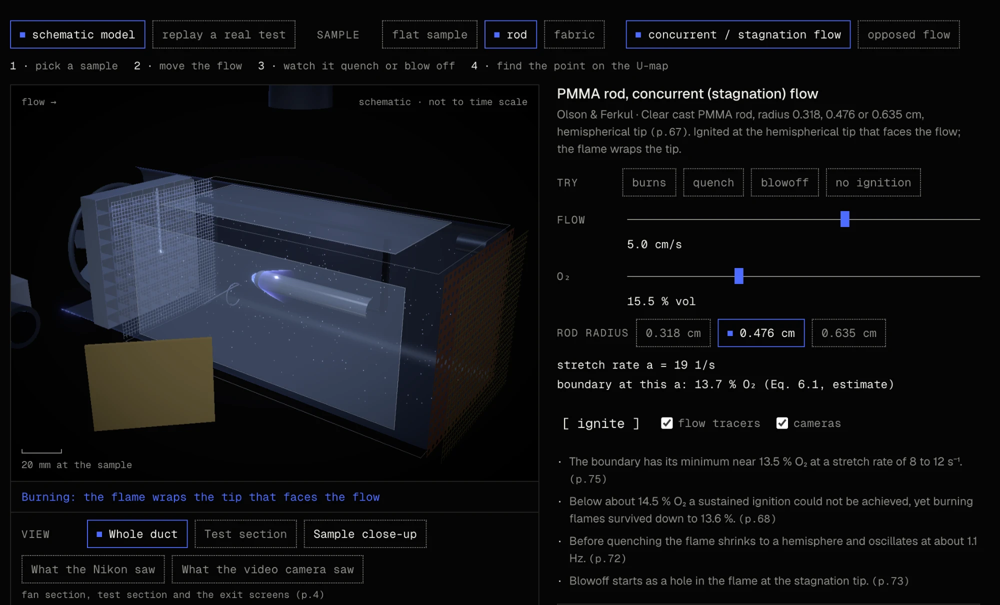
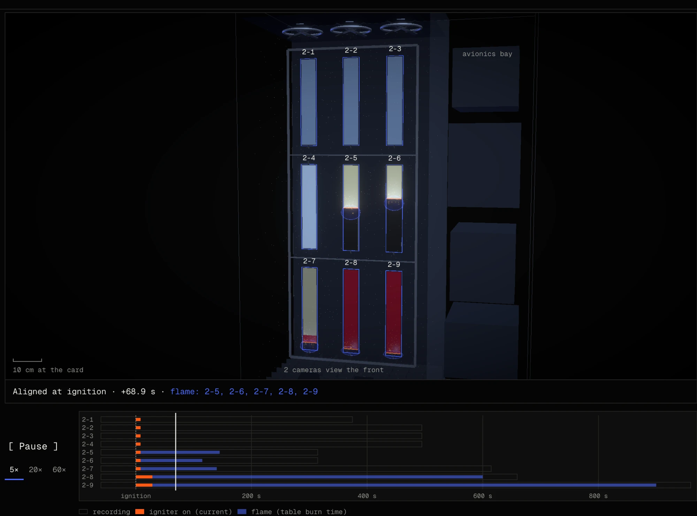

# 🔥 StayHard · Fire without gravity

**NASA Space Apps Challenge 2026 · "Flame in Freefall: SI-Powered Fire Safety Insights from Microgravity Combustion Data"**

StayHard turns NASA's space-fire experiments into something a student can actually read. Pick an experiment flown on the International Space Station, watch it replayed in 3D from the real measurements, look at the charts with plain explanations next to them, and ask an assistant that answers only from NASA's data and shows where every number comes from.

### 👉 Try it: **[frontend-production-6436668c.up.railway.app](https://frontend-production-6436668c.up.railway.app/)**



---

## The problem

Who actually works through the terabytes of data NASA has recorded on fire in microgravity? From NASA reports we learned something surprising: much of it is done by ordinary students and interns. They use this data to learn how to keep crews safe on the ISS today and on the Moon or Mars tomorrow.

On forums we saw how hard that is for them:

- **They get lost.** The results are spread over thousands of files, tables and PDF reports.
- **Their models break.** A formula that works perfectly on paper stops matching the measurements in space, and it is not clear why.

So we read the papers and dissertations of the researchers who had worked with the same data. It turned out the raw numbers hide real phenomena: flames that go out and keep reacting invisibly, droplets that break apart, gaps in recordings that can quietly ruin a calculation. A student staring at a spreadsheet is unlikely to spot any of that.

**Why it matters now.** Lunar habitats and rovers are planned to run at **≥30% O₂ and about 0.7 atm**, an atmosphere much more flammable than Earth's air. NASA has already flown experiments in these conditions. For example, FLEX has 17 droplet tests at about 0.7 atm and 30–34% O₂, and **none of them self-extinguished**. That finding sits in rows of a table that few people will ever open.

## Our solution

StayHard puts all of this on one website. You choose one of **four ISS studies**, and each one has:

1. **An overview** that explains how the experiment was set up, why it was done, what it found, and how to read every chart and formula.
2. **A test catalog** you can filter (for example by fuel, pressure, oxygen level and how the flame ended).
3. **A page for every test** with charts from the real measurements, frames from the onboard cameras and a 3D replay.
4. **A comparison view** to put several tests side by side.
5. **The SI agent**, an assistant you can ask questions in plain language.

The goal is to help future engineers think critically: notice the anomalies and understand *why* their math does not match the experiment.

## A quick tour

### 1. Choose a study

| Study | What it looks at | Size |
|---|---|---|
| **FLEX** (Flame Extinguishment Experiment) | How small fuel droplets burn and go out in zero gravity | 274 tests, 2 fuels, 2009–2011 |
| **SAME-R** (Smoke Aerosol Measurement Experiment) | How the station's smoke detectors react to smoke | 108 tests, 5 materials, 2010 |
| **BASS-II** (Burning and Suppression of Solids) | How flames spread over solid materials in an air flow | 129 tests, 7 materials, 2014–2016 |
| **SAFFIRE-II** (Spacecraft Fire Experiment) | A large fire inside an uncrewed Cygnus cargo ship | 9 samples, 4 materials, 2016–2017 |

### 2. Learn to read the data

Each study opens with the tests worth reading first. The charts are drawn straight from NASA's series, and the text next to them cites the paper behind each point.



Some things we point out, because they trip people up:

- **Gaps in the recording.** If the camera skipped frames, the chart leaves the gap open instead of drawing a line across it. A line there would invent measurements.
- **"The flame went out" is not the same as "burning stopped".** In some tests a *cool flame* keeps reacting after the visible flame is gone. (The temperature chart for this comes from a NASA simulation, PSI-117, and is labelled that way.)



### 3. Open a test and watch it in 3D

The FLEX 3D replay is rebuilt from the measured data, frame by frame. It is not a video: the size of the droplet and of the flame at each moment is the size the ISS instruments recorded. Where NASA has camera frames for a test, real onboard frames are loaded live from NASA next to it.



**The charts are drawn from NASA's own measurements.** When we calculate something ourselves, such as the burning rate of a droplet, it is clearly labelled as *our estimate*, and a simulation is labelled as a simulation.

### 4. Compare tests



### 5. Ask the SI agent

You can ask, for example:

> "Walk me through this test in 3D: the largest flame, the moment it goes out, and what the droplet does afterward."

The agent then drives the 3D scene itself. It pauses at key moments, changes the speed and explains the physics as it goes.

- **Every number in the answer links to its source.** Click a citation and the page highlights that value.
- **It does not make things up.** It answers only from verified data. If the data is not there, it says so.



### 6. Not only droplets

Every study has its own 3D scene. SAME-R and SAFFIRE-II replay real tests from the recorded data. BASS-II has an interactive schematic model (try the flow and oxygen sliders) plus a replay of a real test.

| SAME-R: smoke detectors | BASS-II: solids in a flow | SAFFIRE-II: a large fire |
|---|---|---|
|  |  |  |

## The data behind it

- Everything comes from the **[NASA Physical Sciences Informatics (PSI)](https://psi.nasa.gov/)** archive.
- We took **six ISS experiments** (about **4 TB** of raw data) and condensed the important parts into a **2.6 GB** snapshot: **over a thousand tests** and **about a million measurement points**. Besides the four studies above, the agent can also query CFI (PSI-39) and ACME CFI-G (PSI-159).
- Onboard camera frames are fetched live through the NASA PSI API.
- Our database holds only NASA's open data. Third-party scientific papers are linked through their DOI, not copied.
- To find the right page in NASA's documentation, the agent combines **meaning-based search** (embeddings) with **keyword search** (BM25) and then re-ranks the results. On our FLEX test set the right page is in the top 5 results **93% of the time** (90% on a separate set we never tuned on). It all runs locally, and every answer carries a citation.

## How it is built

```
NASA PSI archive → offline download → data snapshots → one read-only database → API + SI agent → website
```

| Part | Technology |
|---|---|
| Website (`frontend/`) | React, TypeScript, Vite, TanStack Query, React Three Fiber (3D) |
| Server (`backend/`) | Python, FastAPI, DuckDB |
| Document search | Local embeddings (bge-small) + BM25 + cross-encoder re-ranking |
| SI agent | Claude, streamed to the browser |
| Hosting | Two Docker services on Railway, deployed automatically from `main` |

The data never changes while the site runs. The database is rebuilt offline from versioned snapshots and opened read-only.

## Run it yourself

You need Python 3.13 with [uv](https://docs.astral.sh/uv/), Node.js 22+, and optionally Docker.

```bash
# server, http://localhost:8000 (API docs at /docs)
cd backend && uv sync && uv run uvicorn flame.main:app --reload
```

```bash
# website, http://localhost:5173
cd frontend && npm install && npm run dev
```

Or start both with Docker:

```bash
docker compose up --build
```

The data (about 540 MB for FLEX alone) is not stored in git. Downloading it, building the database and setting the API keys are described in [docs/development.md](docs/development.md). The variable names are listed in `.env.example`; keep real keys in your own `.env` and never commit them.

## Documentation

Developer docs (in Ukrainian) start at [docs/README.md](docs/README.md): architecture, data schemas, the agent, search, deployment, and design decisions.

## Glossary

- **Microgravity**: the near-weightless conditions on the ISS. Without gravity, hot gas does not rise, so a flame around a droplet becomes a sphere instead of a teardrop.
- **d² law**: while a droplet burns steadily, the square of its diameter shrinks in a straight line over time. The slope is the burning-rate constant **K**.
- **Extinction / Disruption**: how a FLEX test ended. *Extinction* means the flame went out on its own. *Disruption* means that was not observed (for example, the droplet broke apart). It does **not** mean the flame would have burned forever.
- **Cool flame**: low-temperature chemical reactions that continue after the visible flame is gone.
- **PSI**: NASA's Physical Sciences Informatics, the public archive of physical-science experiments from the ISS.

## Team

Built during NASA Space Apps Challenge 2026 by the StayHard team:

Oleksii Martyniuk · Mykyta Cherniavskyi · Bohdan Parkulab · Sofiia Stoliar · Oleksandr Zalievskyi · Heorhii Shvets


## Data and credits

- Data: NASA Physical Sciences Informatics, CC0-1.0. Please cite the study DOI; the FLEX DOI is in `data/flex/about.json`.
- Font: IBM VGA 8×16 from the Oldschool PC Font Pack, © VileR, CC BY-SA 4.0.
